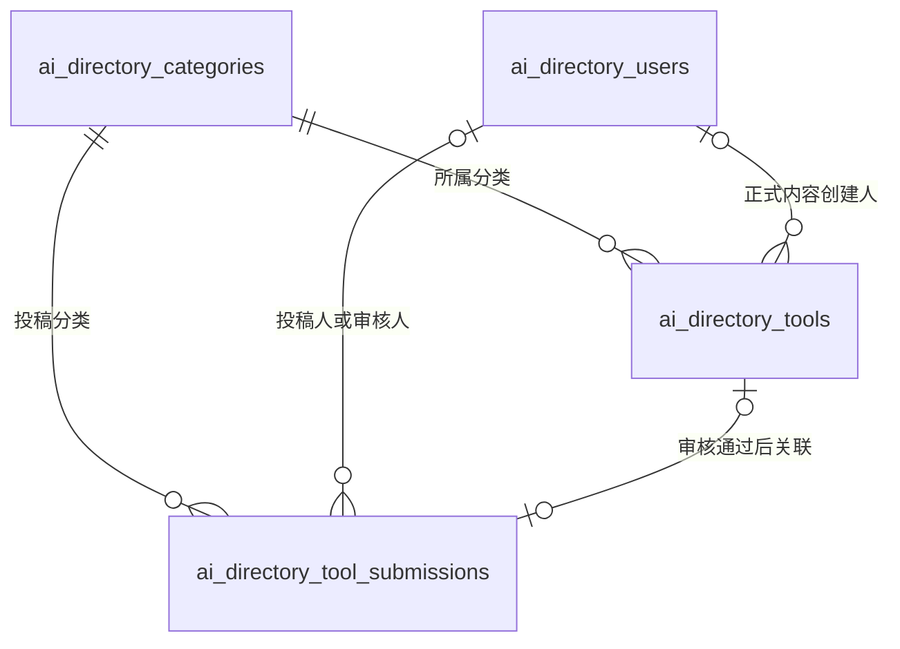
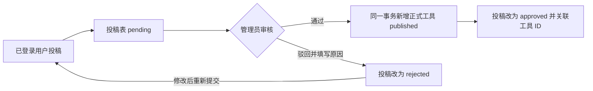

# AI 工具导航数据库设计方案

> 当前图片存储增量（2026-11-20）：正式工具与投稿表新增 `logo_url`、`cover_url`，分别保存 `/media/<sha256>.webp`、`/private-media/<sha256>.webp`。图片文件存于持久磁盘，旧 `*_data`、`*_type` 字段在验证迁移后清空并由约束禁止重新写入。新增 `ai_directory_settings` 配置表，`media_base_url` 默认 `/`，仅影响正式工具的公开访问前缀。增量 SQL 为 [media-storage.sql](../db/media-storage.sql)，迁移命令、权限规则和部署说明见 [README](../README.md#本地图片与独立图片服务器)。下文含二进制字段的初始 DDL 和 SQL 保留为历史设计，不再作为当前应用图片写入方式。

> 版本：1.1 · 日期：2026-11-19 · 目标数据库：PostgreSQL 18
>
> 本文包含完整建表、分类初始化及关键业务 SQL。三张业务表与 17 个分类已在用户授权后初始化，当前应用已完成三表接入、动态分类、投稿审核、管理入口与媒体权限适配。三个业务表不包含项目已经存在的 Better Auth 认证表。

配套可审阅脚本：[三表建表及分类初始化 SQL](../db/directory-v2.sql)。该脚本将第 5、6 节合并为一个事务；第 7 节参数化业务 SQL 仍在本文中提供，不混入初始化脚本。若使用 `psql`，加 `-v ON_ERROR_STOP=1`，避免初始化报错后继续执行后续操作。

### 1.1 版本增量：前后台认证分离

工具列表增量：正式工具表新增 `deleted_at timestamptz`，详见 [工具管理增量 SQL](../db/tool-management.sql)。非空表示逻辑删除，前台列表、详情、公开媒体与后台列表均隐藏；保留外键和审核历史，已删除 Slug 不释放。后台支持关键词、分类、状态查询，分页，以及独立新增/编辑表单和行内上下架、确认删除。维护脚本 `pnpm admin:migrate` 包含该增量，不会删除真实记录。

后台不再使用前台用户的 `role`，也不读取前台会话。管理员独立存储于 `admin_user`，密码哈希于 `admin_account`，会话于 `admin_session`，配套 `admin_verification`、`admin_rate_limit`。后台 `/api/admin-auth/*` 与前台 `/api/auth/*` 使用不同 Cookie 和签名域，可同时登录、分别退出；公开接口不能注册管理员。

先初始化三张业务表，再执行 [后台认证表 SQL](../db/admin-auth.sql) 与 [管理员关联增量 SQL](../db/admin-audit-migration.sql)，或由维护者执行 `pnpm admin:migrate`。当前数据库已完成此增量。维护者用 `pnpm admin:create` 在终端交互创建独立管理员，不自动复制或提升前台账号。

下文第 5 节保留三表初始建表结构；旧 `created_by`、`reviewed_by` 保留历史，不能再用来写入新管理员身份。增量新增 `created_by_admin`、`reviewed_by_admin`，均外键关联 `admin_user(id)`；下文审核 SQL 已改用新字段。业务表仍只有三张，新增的是独立认证基础表。

## 1. 设计结论

| 表名 | 职责 | 是否供公开页面读取 |
| --- | --- | --- |
| `ai_directory_categories` | 首页左侧分类、分类标题、短名称、描述、图标配置与排序 | 是，仅启用分类 |
| `ai_directory_tools` | 已审核收录的正式 AI 工具，可发布或下架 | 是，仅已发布工具 |
| `ai_directory_tool_submissions` | 用户投稿内容快照、审核状态、审核人、驳回原因及收录结果 | 否，仅投稿人本人和管理员 |

核心原则：**投稿先进入投稿表，审核通过后复制到正式工具表，投稿记录不删除。**

“热门工具”“最新收录”属于正式工具的查询结果，不是工具分类，不作为分类记录写入数据库。“提交站点”“登录”等操作入口也不是分类。

### 1.1 与当前项目的对应关系

| 代码位置 | 改造前情况 | 当前三表实现 |
| --- | --- | --- |
| [分类定义](../lib/catalog.ts) | 17 个分类写在代码数组中 | 从分类表读取，保持现有分类 ID 和页面锚点 |
| [目录组件](../components/directory.tsx) | 分类导航、筛选项和内容分组依赖静态数组 | 使用服务端传入的数据库分类列表 |
| [图标映射](../components/catalog-elements.tsx) | 分类 ID 对应 Lucide 图标组件 | 根据分类表的 `icon_key` 映射到前端白名单组件 |
| [工具数据模型](../lib/directory-db.ts) | 以 `slug` 为主键；待审核与正式工具共表 | 正式工具用稳定数字 ID，`slug` 保留唯一约束和详情路由用途 |
| [投稿操作](../app/account/actions.ts) | 用户投稿直接插入工具表，状态为 `pending` | 只插入投稿表 |
| [审核逻辑](../lib/directory-submissions.ts) | 将工具从 `pending` 改成 `published` | 同一事务内新增正式工具、回写投稿审核结果 |
| [媒体接口](../app/api/tool-media/[slug]/[kind]/route.ts) | 从工具表同时读取公开与待审核图片 | 公开图片仍从正式工具表读取，投稿预览改为按投稿 ID 读取投稿表 |

新工具表结构与旧的单表布局不同，当前代码已适配新结构。原 [建表脚本](../db/schema.sql) 已停用，避免新部署误建旧表；新数据库使用配套三表脚本，已有旧表需单独迁移。

## 2. 业务边界与关系

第一版保持项目现有的“一个工具只属于一个分类”，不新增多对多关联表；分类暂不做父子层级。



说明：

- 分类与正式工具、投稿记录均为一对多。
- 一条投稿最多生成一个正式工具；第一版一个正式工具最多对应一条通过的投稿。
- 管理员可直接新增正式工具，此时没有对应投稿。
- `published_tool_id` 是投稿表指向正式工具的唯一外键，不在两张表中互设外键，避免循环依赖。
- 不新增用户表。投稿人、审核人、正式内容创建人均关联现有 `ai_directory_users.id`，类型使用 `text`，与 Better Auth 保持一致。
- 三个业务表与认证表位于当前项目已有的 `"ai-tools"` schema；PostgreSQL 数据库名与 schema 名是不同概念，只是本项目目前同名。
- 用户被物理删除时，用户外键设为 `NULL`，投稿与审核记录继续保留；界面显示“账号已注销”。不因删除账号而级联删除已收录工具。

## 3. 表结构设计

### 3.1 分类表：`ai_directory_categories`

分类 ID 直接沿用 `writing`、`image`、`side-hustle` 等现有标识，不额外引入无业务价值的数字分类 ID。分类名称可以调整，分类 ID 作为稳定引用不随名称变化。

| 字段 | 类型 | 可空 / 默认值 | 说明 |
| --- | --- | --- | --- |
| `id` | `varchar(40)` | 非空，主键 | 稳定分类标识，同时用于首页锚点 |
| `name` | `varchar(50)` | 非空 | 完整分类名称，如“AI 写作工具” |
| `short_name` | `varchar(30)` | 非空 | 工具卡片使用的短名称，如“AI 写作” |
| `description` | `varchar(200)` | 非空，默认空字符串 | 分类板块说明 |
| `icon_key` | `varchar(50)` | 非空 | Lucide 图标白名单键，如 `PenLine` |
| `sort_order` | `integer` | 非空，默认 `0` | 数值越小，左侧导航越靠前；相同则按 ID 排序 |
| `is_enabled` | `boolean` | 非空，默认 `true` | 是否开放展示和新投稿 |
| `created_at` | `timestamptz` | 非空，默认当前时间 | 创建时间 |
| `updated_at` | `timestamptz` | 非空，默认当前时间 | 最近修改时间 |

规则：分类有引用时不能物理删除；需要隐藏时设置 `is_enabled = false`。禁用分类同时从公开分类、热门、最新收录及详情查询中隐藏，已有投稿仍可查看，但不能继续向该分类投稿或通过审核；需要先重新启用或调整投稿分类。

### 3.2 正式工具表：`ai_directory_tools`

该表不允许 `pending`、`rejected` 状态。进入该表即表示内容已正式收录，是否对公众展示再由 `status` 控制。

| 字段 | 类型 | 可空 / 默认值 | 说明 |
| --- | --- | --- | --- |
| `id` | `bigint identity` | 非空，主键 | 稳定内部 ID，自动生成 |
| `slug` | `varchar(70)` | 非空，唯一 | 详情页标识，如 `/tools/my-ai-tool` |
| `category_id` | `varchar(40)` | 非空，外键 | 所属分类 |
| `name` | `varchar(90)` | 非空 | 工具名称 |
| `website` | `varchar(1500)` | 非空 | 工具官网 URL |
| `summary` | `varchar(130)` | 非空 | 卡片摘要 |
| `content` | `text` | 非空 | Markdown 详情，最多 12,000 字符 |
| `logo_key` | `varchar(40)` | 可空 | 项目已有品牌 SVG 的白名单键；如有上传 Logo，则优先使用上传图片 |
| `logo_data` | `bytea` | 可空 | 标准化后的 Logo 内容 |
| `logo_type` | `varchar(30)` | 可空 | 有图片时固定为 `image/webp` |
| `cover_data` | `bytea` | 可空 | 标准化后的预览图内容 |
| `cover_type` | `varchar(30)` | 可空 | 有图片时固定为 `image/webp` |
| `featured_order` | `integer` | 可空 | 热门展示顺序；`NULL` 表示不进入热门列表 |
| `display_order` | `integer` | 非空，默认 `0` | 同分类中人工排序；相同时按收录时间和 ID 排序 |
| `status` | `varchar(16)` | 非空，默认 `published` | `published` 已发布 / `disabled` 已下架 |
| `created_by` | `text` | 可空，外键 | 创建正式内容的管理员，不代表原始投稿人 |
| `created_at` | `timestamptz` | 非空，默认当前时间 | 正式记录创建时间 |
| `updated_at` | `timestamptz` | 非空，默认当前时间 | 最近修改时间 |
| `published_at` | `timestamptz` | 非空，默认当前时间 | 首次正式收录时间，用于“最新收录” |

规则：

- `id` 是主键，`slug` 是路由标识。上线后原则上不修改 `slug`；若要修改并保留旧链接，需要另行设计重定向机制。
- `website` 不设数据库唯一约束。同一官网可能对应多个产品、入口或版本，是否重复由审核判断，不能简单按域名去重。
- 第一版沿用项目已有的数据库图片存储方式，不额外依赖对象存储。Logo 最多 512 KiB、封面最多 2 MiB；服务端转码后也要重新校验输出大小。
- `created_by` 记录发布管理员。原始投稿人通过投稿表关联查询，不在正式表重复存储。
- 正式工具优先下架，不物理删除；有关联投稿时，外键会阻止直接删除工具。
- 编辑摘要或切换下架状态不修改首次 `published_at`，避免旧工具被误判为新收录。

### 3.3 投稿记录表：`ai_directory_tool_submissions`

投稿表保存用户当时提交的完整内容。它和正式工具的字段适度重复，是为了保留原始内容快照，而不是依赖正式工具的最新内容倒推历史。

| 字段 | 类型 | 可空 / 默认值 | 说明 |
| --- | --- | --- | --- |
| `id` | `bigint identity` | 非空，主键 | 投稿记录 ID；个人历史及管理员操作均使用此 ID |
| `submitted_by` | `text` | 可空，外键 | 投稿人；正常投稿必须由服务端写入当前登录用户 ID，删除账号后才可为空 |
| `requested_slug` | `varchar(70)` | 非空 | 用户申请的正式工具 Slug，审核前不占用正式工具 Slug |
| `category_id` | `varchar(40)` | 非空，外键 | 用户提交时选择的分类 |
| `name` | `varchar(90)` | 非空 | 投稿工具名称 |
| `website` | `varchar(1500)` | 非空 | 投稿工具官网 |
| `summary` | `varchar(130)` | 非空 | 投稿摘要 |
| `content` | `text` | 非空 | 原始 Markdown 介绍，最多 12,000 字符 |
| `logo_data` | `bytea` | 可空 | 用户上传且已标准化的 Logo |
| `logo_type` | `varchar(30)` | 可空 | 有图时固定为 `image/webp` |
| `cover_data` | `bytea` | 可空 | 用户上传且已标准化的预览图 |
| `cover_type` | `varchar(30)` | 可空 | 有图时固定为 `image/webp` |
| `status` | `varchar(16)` | 非空，默认 `pending` | `pending` 待审核 / `approved` 已通过 / `rejected` 已驳回 |
| `reviewed_by` | `text` | 可空，外键 | 审核管理员；未审核或审核人被删除时为空 |
| `reviewed_at` | `timestamptz` | 可空 | 审核完成时间 |
| `rejection_reason` | `varchar(1000)` | 可空 | 驳回时必填；其余状态为空 |
| `published_tool_id` | `bigint` | 可空，唯一外键 | 审核通过后生成的正式工具 ID |
| `submitted_at` | `timestamptz` | 非空，默认当前时间 | 投稿时间 |
| `updated_at` | `timestamptz` | 非空，默认当前时间 | 最近状态变更时间 |

审核后的投稿不再修改原始名称、网址、摘要和图片；管理员后续编辑正式工具，不反向覆盖投稿快照。驳回后重新提交则新增一条投稿，原驳回记录保留。第一版不在一条记录上反复审核，因此无需第四张审核日志表；如果将来支持撤审、多级审核或逐次意见留痕，应另外设计事件日志。

同一用户不能同时存在两条相同 `requested_slug` 的待审核投稿，通过部分唯一索引控制。不同用户可以提交相同 Slug；最终由正式工具的唯一约束决定谁可以收录，避免未审核投稿长期占用公开路由。

## 4. 状态与审核规则



| 投稿状态 | 正式工具关联 | 审核时间 | 驳回原因 |
| --- | --- | --- | --- |
| `pending` | 必须为空 | 必须为空 | 必须为空 |
| `approved` | 必须非空 | 必须非空 | 必须为空 |
| `rejected` | 必须为空 | 必须非空 | 必须为非空白文本 |

业务写入时审核人必须来自当前管理员会话。数据库不要求审核人字段永久非空，因为后续删除账号会将该外键置空，但审核时间与审核结果仍保留。

审核通过必须满足：当前操作人是管理员、投稿仍为待审核、分类启用、正式 Slug 未被占用。锁定投稿行后再发布，避免两个管理员重复处理同一条记录；插入与状态更新在同一事务内完成。唯一约束、外键和行锁的行为以 [PostgreSQL 约束说明](https://www.postgresql.org/docs/18/ddl-constraints.html)及[行锁说明](https://www.postgresql.org/docs/18/explicit-locking.html)为依据。

## 5. 完整建表 SQL

### 5.1 执行前提

1. 先确认应用连接的目标数据库正确，沿用现有 `DATABASE_URL` 和严格校验证书的 `DB_CA_CERT` 配置。
2. 项目现有认证表 `"ai-tools".ai_directory_users` 已存在，其 `id` 为 `text`。
3. 本文针对新建三张业务表，不是已存在业务表的自动升级脚本。若已有旧版 `ai_directory_tools`，先按第 9 节制定迁移，不直接覆盖。
4. 以下脚本明确选用本项目已有的 `"ai-tools"` schema。其他部署若使用不同 schema，需要统一修改搜索路径，并保证认证表可见；不要依赖 `public` 的建表权限。
5. `CREATE TABLE` 不使用 `IF NOT EXISTS`：遇到同名旧表时直接失败，避免误以为旧表已具备新字段和约束。事务失败应执行 `ROLLBACK`，修正原因后再重试。

```sql
BEGIN;

SET LOCAL search_path = "ai-tools", public;

-- 防止目标 schema 缺失时意外回退到 public。
DO $$
BEGIN
    IF current_schema() IS DISTINCT FROM 'ai-tools' THEN
        RAISE EXCEPTION 'Target schema ai-tools is unavailable';
    END IF;
END;
$$;

CREATE TABLE ai_directory_categories (
    id           varchar(40) PRIMARY KEY,
    name         varchar(50) NOT NULL CHECK (btrim(name) <> ''),
    short_name   varchar(30) NOT NULL CHECK (btrim(short_name) <> ''),
    description  varchar(200) NOT NULL DEFAULT '',
    icon_key     varchar(50) NOT NULL CHECK (btrim(icon_key) <> ''),
    sort_order   integer NOT NULL DEFAULT 0 CHECK (sort_order >= 0),
    is_enabled   boolean NOT NULL DEFAULT true,
    created_at   timestamptz NOT NULL DEFAULT CURRENT_TIMESTAMP,
    updated_at   timestamptz NOT NULL DEFAULT CURRENT_TIMESTAMP,
    CONSTRAINT categories_id_format
        CHECK (id ~ '^[a-z0-9]+(-[a-z0-9]+)*$')
);

CREATE TABLE ai_directory_tools (
    id              bigint GENERATED ALWAYS AS IDENTITY PRIMARY KEY,
    slug            varchar(70) NOT NULL UNIQUE,
    category_id     varchar(40) NOT NULL
                    REFERENCES ai_directory_categories(id) ON DELETE RESTRICT,
    name            varchar(90) NOT NULL CHECK (btrim(name) <> ''),
    website         varchar(1500) NOT NULL,
    summary         varchar(130) NOT NULL CHECK (btrim(summary) <> ''),
    content         text NOT NULL,
    logo_key        varchar(40),
    logo_data       bytea,
    logo_type       varchar(30),
    cover_data      bytea,
    cover_type      varchar(30),
    featured_order  integer CHECK (featured_order >= 0),
    display_order   integer NOT NULL DEFAULT 0 CHECK (display_order >= 0),
    status          varchar(16) NOT NULL DEFAULT 'published',
    created_by      text REFERENCES ai_directory_users(id) ON DELETE SET NULL,
    created_at      timestamptz NOT NULL DEFAULT CURRENT_TIMESTAMP,
    updated_at      timestamptz NOT NULL DEFAULT CURRENT_TIMESTAMP,
    published_at    timestamptz NOT NULL DEFAULT CURRENT_TIMESTAMP,
    CONSTRAINT tools_slug_format
        CHECK (slug ~ '^[a-z0-9]+(-[a-z0-9]+)*$'),
    CONSTRAINT tools_website_format
        CHECK (website ~ '^https?://[^[:space:]]+$'),
    CONSTRAINT tools_content_length
        CHECK (char_length(content) BETWEEN 1 AND 12000 AND btrim(content) <> ''),
    CONSTRAINT tools_status_values
        CHECK (status IN ('published', 'disabled')),
    CONSTRAINT tools_logo_pair
        CHECK (
            (logo_data IS NULL AND logo_type IS NULL)
            OR
            (logo_data IS NOT NULL AND logo_type IS NOT NULL
             AND logo_type = 'image/webp'
             AND octet_length(logo_data) BETWEEN 1 AND 524288)
        ),
    CONSTRAINT tools_cover_pair
        CHECK (
            (cover_data IS NULL AND cover_type IS NULL)
            OR
            (cover_data IS NOT NULL AND cover_type IS NOT NULL
             AND cover_type = 'image/webp'
             AND octet_length(cover_data) BETWEEN 1 AND 2097152)
        )
);

CREATE TABLE ai_directory_tool_submissions (
    id                 bigint GENERATED ALWAYS AS IDENTITY PRIMARY KEY,
    submitted_by       text REFERENCES ai_directory_users(id) ON DELETE SET NULL,
    requested_slug     varchar(70) NOT NULL,
    category_id        varchar(40) NOT NULL
                       REFERENCES ai_directory_categories(id) ON DELETE RESTRICT,
    name               varchar(90) NOT NULL CHECK (btrim(name) <> ''),
    website            varchar(1500) NOT NULL,
    summary            varchar(130) NOT NULL CHECK (btrim(summary) <> ''),
    content            text NOT NULL,
    logo_data          bytea,
    logo_type          varchar(30),
    cover_data         bytea,
    cover_type         varchar(30),
    status             varchar(16) NOT NULL DEFAULT 'pending',
    reviewed_by        text REFERENCES ai_directory_users(id) ON DELETE SET NULL,
    reviewed_at        timestamptz,
    rejection_reason   varchar(1000),
    published_tool_id  bigint UNIQUE
                       REFERENCES ai_directory_tools(id) ON DELETE RESTRICT,
    submitted_at       timestamptz NOT NULL DEFAULT CURRENT_TIMESTAMP,
    updated_at         timestamptz NOT NULL DEFAULT CURRENT_TIMESTAMP,
    CONSTRAINT submissions_slug_format
        CHECK (requested_slug ~ '^[a-z0-9]+(-[a-z0-9]+)*$'),
    CONSTRAINT submissions_website_format
        CHECK (website ~ '^https?://[^[:space:]]+$'),
    CONSTRAINT submissions_content_length
        CHECK (char_length(content) BETWEEN 1 AND 12000 AND btrim(content) <> ''),
    CONSTRAINT submissions_status_values
        CHECK (status IN ('pending', 'approved', 'rejected')),
    CONSTRAINT submissions_review_shape
        CHECK (
            (status = 'pending'
             AND reviewed_by IS NULL AND reviewed_at IS NULL
             AND rejection_reason IS NULL AND published_tool_id IS NULL)
            OR
            (status = 'approved'
             AND reviewed_at IS NOT NULL
             AND rejection_reason IS NULL AND published_tool_id IS NOT NULL)
            OR
            (status = 'rejected'
             AND reviewed_at IS NOT NULL AND published_tool_id IS NULL
             AND rejection_reason IS NOT NULL AND btrim(rejection_reason) <> '')
        ),
    CONSTRAINT submissions_review_time
        CHECK (reviewed_at IS NULL OR reviewed_at >= submitted_at),
    CONSTRAINT submissions_logo_pair
        CHECK (
            (logo_data IS NULL AND logo_type IS NULL)
            OR
            (logo_data IS NOT NULL AND logo_type IS NOT NULL
             AND logo_type = 'image/webp'
             AND octet_length(logo_data) BETWEEN 1 AND 524288)
        ),
    CONSTRAINT submissions_cover_pair
        CHECK (
            (cover_data IS NULL AND cover_type IS NULL)
            OR
            (cover_data IS NOT NULL AND cover_type IS NOT NULL
             AND cover_type = 'image/webp'
             AND octet_length(cover_data) BETWEEN 1 AND 2097152)
        )
);

-- 分类导航：只索引启用分类。
CREATE INDEX categories_enabled_order_idx
    ON ai_directory_categories (sort_order, id)
    WHERE is_enabled = true;

-- 分类外键的通用索引，同时服务后台查询和引用检查。
CREATE INDEX tools_category_idx ON ai_directory_tools (category_id);
CREATE INDEX submissions_category_idx ON ai_directory_tool_submissions (category_id);

-- 分类工具列表、最新收录、热门工具。
CREATE INDEX tools_category_published_idx
    ON ai_directory_tools (category_id, display_order, published_at DESC, id DESC)
    WHERE status = 'published';
CREATE INDEX tools_latest_idx
    ON ai_directory_tools (published_at DESC, id DESC)
    WHERE status = 'published';
CREATE INDEX tools_featured_idx
    ON ai_directory_tools (featured_order, id)
    WHERE status = 'published' AND featured_order IS NOT NULL;

-- 用户提交历史、管理员待审核列表。
CREATE INDEX submissions_user_history_idx
    ON ai_directory_tool_submissions (submitted_by, submitted_at DESC, id DESC);
CREATE INDEX submissions_pending_idx
    ON ai_directory_tool_submissions (submitted_at, id)
    WHERE status = 'pending';

-- 同一用户对同一 Slug 只能存在一条待审核投稿。
CREATE UNIQUE INDEX submissions_user_pending_slug_uidx
    ON ai_directory_tool_submissions (submitted_by, requested_slug)
    WHERE status = 'pending';

-- 用户外键引用检查，避免删除用户时全表扫描。
CREATE INDEX tools_creator_idx ON ai_directory_tools (created_by);
CREATE INDEX submissions_reviewer_idx ON ai_directory_tool_submissions (reviewed_by);

COMMENT ON TABLE ai_directory_categories IS '首页工具分类与导航配置';
COMMENT ON TABLE ai_directory_tools IS '已正式收录的工具，不存放待审核投稿';
COMMENT ON TABLE ai_directory_tool_submissions IS '用户原始投稿快照及最终审核结果';
COMMENT ON COLUMN ai_directory_tool_submissions.published_tool_id IS '通过后关联正式工具，原始投稿保留';
COMMENT ON COLUMN ai_directory_tools.featured_order IS 'NULL 不进入热门列表，非空时越小越靠前';

COMMIT;
```

补充约束说明：

- SQL 的 URL 正则只做粗校验。服务端仍须使用现有 `websiteUrl()` 校验协议、主机名和账号密码字段，不允许在 URL 中携带用户名密码。
- 数据库无法通过 MIME 字符串确认图片真实格式，仍须调用现有 `normalizeImage()` 解码、检查像素、转为 WebP，再验证输出字节数。
- `updated_at` 的默认值仅在插入时生效；本文未增加触发器，所有更新 SQL 必须显式写入 `updated_at = CURRENT_TIMESTAMP`。
- 图标与品牌键只存配置值，前端通过白名单匹配组件/资源，不把数据库字符串当作任意脚本、文件路径或 HTML 执行。
- `bigint` ID 在 Node.js/JSON 边界使用字符串或明确的 BigInt 转换策略，不直接转换成可能超出安全范围的 JavaScript `number`。

## 6. 初始化当前 17 个分类

保留当前项目的分类顺序、描述与图标映射。此 SQL 可单独执行，已有相同 ID 的分类不会被覆盖；若需要修改名称和排序，应明确使用管理操作，而不是重复初始化覆盖人工维护结果。

```sql
BEGIN;
SET LOCAL search_path = "ai-tools", public;

INSERT INTO ai_directory_categories
    (id, name, short_name, description, icon_key, sort_order)
VALUES
    ('writing', 'AI 写作工具', 'AI 写作', '从灵感、提纲到定稿，帮你写得更快。', 'PenLine', 10),
    ('image', 'AI 图像工具', 'AI 图像', '发现图像生成、视觉设计和图片编辑工具。', 'Image', 20),
    ('video', 'AI 视频工具', 'AI 视频', '让创意从文字、图片或分镜走进视频。', 'Video', 30),
    ('office', 'AI 办公工具', 'AI 办公', '整理资料、制作演示文稿，减少重复工作。', 'LibraryBig', 40),
    ('chat', 'AI 聊天助手', 'AI 对话', '问答、推理和日常协作的智能伙伴。', 'MessageCircle', 50),
    ('agents', 'AI 智能体', 'AI 智能体', '发现能调用工具、协作和完成多步骤任务的智能体。', 'Bot', 60),
    ('code', 'AI 编程工具', 'AI 编程', '理解代码、调试问题并辅助日常开发。', 'Code2', 70),
    ('platforms', 'AI 开发平台', 'AI 开发', '探索构建、测试和部署 AI 应用的平台。', 'Laptop', 80),
    ('design', 'AI 设计工具', 'AI 设计', '辅助界面设计、品牌视觉和创意排版。', 'Palette', 90),
    ('audio', 'AI 音频工具', 'AI 音频', '探索语音合成、配音和音乐创作工具。', 'AudioLines', 100),
    ('search', 'AI 搜索引擎', 'AI 搜索', '检索网络信息、整理线索并追踪来源。', 'Search', 110),
    ('learning', 'AI 学习网站', 'AI 学习', '从入门课程到实战教程，按自己的节奏学习 AI。', 'GraduationCap', 120),
    ('training', 'AI 训练模型', '模型训练', '查找用于训练、微调和管理 AI 模型的资源。', 'BrainCircuit', 130),
    ('evaluation', 'AI 模型评测', '模型评测', '通过基准测试和排行榜比较不同模型的表现。', 'ClipboardCheck', 140),
    ('detection', 'AI 内容检测', '内容检测', '发现辅助识别 AI 生成内容和核查内容来源的工具。', 'ScanText', 150),
    ('prompts', 'AI 提示指令', 'AI 提示词', '查找、整理和改写适合不同任务的提示词。', 'Terminal', 160),
    ('side-hustle', 'AI 副业工具', 'AI 副业', '寻找辅助内容制作、接单和独立项目的工具。', 'BriefcaseBusiness', 170)
ON CONFLICT (id) DO NOTHING;

COMMIT;
```

## 7. 关键业务 SQL

以下均是应用层参数化 SQL 模板，`$1`、`$2` 等由 `pg` 参数数组提供，不是可直接粘贴执行的固定测试数据。生产连接应沿用本项目默认 `"$user", public` 搜索路径，或明确使用 `"ai-tools"` schema；这里为便于阅读省略每个表名前的 schema 前缀。

### 7.1 首页左侧分类

```sql
SELECT id, name, short_name, description, icon_key, sort_order
FROM ai_directory_categories
WHERE is_enabled = true
ORDER BY sort_order ASC, id ASC;
```

### 7.2 分类工具列表与数量

```sql
-- $1 = 分类 ID，$2 = 每页条数，$3 = 偏移量。
-- 服务端限制 $2 为 1～100，$3 为非负整数。
SELECT t.id, t.slug, t.name, t.website, t.summary, t.logo_key,
       t.logo_data IS NOT NULL AS has_logo,
       t.cover_data IS NOT NULL AS has_cover,
       t.category_id, c.name AS category_name, c.short_name,
       t.featured_order, t.published_at
FROM ai_directory_tools AS t
JOIN ai_directory_categories AS c ON c.id = t.category_id
WHERE t.status = 'published' AND c.is_enabled = true
  AND t.category_id = $1
ORDER BY t.display_order ASC, t.published_at DESC, t.id DESC
LIMIT $2 OFFSET $3;

-- LEFT JOIN 保留工具数量为 0 的启用分类。
SELECT c.id, c.name, count(t.id) AS tool_count
FROM ai_directory_categories AS c
LEFT JOIN ai_directory_tools AS t
       ON t.category_id = c.id AND t.status = 'published'
WHERE c.is_enabled = true
GROUP BY c.id, c.name, c.sort_order
ORDER BY c.sort_order ASC, c.id ASC;
```

目录列表不要 `SELECT t.*`，否则会把二进制图片和长文一并拉取。工具详情再按 Slug 读取 `content`，图片由媒体接口单独读取。

### 7.3 热门与最新收录

```sql
-- 热门工具。
SELECT t.id, t.slug, t.name, t.summary, t.category_id,
       t.logo_key, t.logo_data IS NOT NULL AS has_logo
FROM ai_directory_tools AS t
JOIN ai_directory_categories AS c ON c.id = t.category_id
WHERE t.status = 'published' AND c.is_enabled = true
  AND t.featured_order IS NOT NULL
ORDER BY t.featured_order ASC, t.id ASC
LIMIT 8;

-- 最新收录。
SELECT t.id, t.slug, t.name, t.summary, t.category_id,
       t.logo_key, t.logo_data IS NOT NULL AS has_logo
FROM ai_directory_tools AS t
JOIN ai_directory_categories AS c ON c.id = t.category_id
WHERE t.status = 'published' AND c.is_enabled = true
ORDER BY t.published_at DESC, t.id DESC
LIMIT 8;
```

### 7.4 用户提交工具

`$1` 必须由服务端当前登录会话取得，不接受浏览器传入的用户 ID。其余字段经过服务端校验和图片标准化处理。

```sql
-- $1 投稿用户 ID；$2 申请 Slug；$3 分类 ID；$4 名称；$5 官网；
-- $6 摘要；$7 Markdown；$8 Logo bytea 或 NULL；$9 对应 MIME 或 NULL；
-- $10 封面 bytea 或 NULL；$11 对应 MIME 或 NULL。
INSERT INTO ai_directory_tool_submissions (
    submitted_by, requested_slug, category_id, name, website,
    summary, content, logo_data, logo_type, cover_data, cover_type
)
SELECT $1::text, $2::text, c.id, $4::text, $5::text, $6::text, $7::text,
       $8::bytea, $9::text, $10::bytea, $11::text
FROM ai_directory_categories AS c
WHERE c.id = $3 AND c.is_enabled = true
  AND EXISTS (SELECT 1 FROM ai_directory_users WHERE id = $1)
RETURNING id, status, submitted_at;
```

返回 0 行表示用户/分类不存在或分类已禁用。`23505` 且约束为 `submissions_user_pending_slug_uidx` 表示当前用户已有相同 Slug 的待审核记录。允许前置查询是否已被收录来改善提示，但审核入库时仍必须依赖正式表的唯一约束。

### 7.5 用户查看自己的投稿记录

```sql
-- $1 必须来自当前登录会话；$2 / $3 为服务端校验后的分页参数。
SELECT s.id, s.requested_slug, s.name, s.status, s.submitted_at,
       s.reviewed_at, s.rejection_reason, s.published_tool_id,
       t.slug AS published_slug, t.status AS tool_status
FROM ai_directory_tool_submissions AS s
LEFT JOIN ai_directory_tools AS t ON t.id = s.published_tool_id
WHERE s.submitted_by = $1
ORDER BY s.submitted_at DESC, s.id DESC
LIMIT $2 OFFSET $3;
```

展示投稿原始名称与最终正式链接两个概念。工具下架不改变投稿“已通过”结果，但界面不应给下架工具显示公开可访问的详情链接。

### 7.6 管理员审核队列

查询前复用项目 `isAdmin()` 的管理员检查。审核写操作仍需重新验证，不能以“曾打开过管理页面”代替权限校验。

```sql
SELECT s.id, s.name, s.requested_slug, s.website, s.summary,
       s.category_id, c.name AS category_name, c.is_enabled AS category_enabled,
       s.submitted_by, u.name AS submitter_name, s.submitted_at
FROM ai_directory_tool_submissions AS s
JOIN ai_directory_categories AS c ON c.id = s.category_id
LEFT JOIN ai_directory_users AS u ON u.id = s.submitted_by
WHERE s.status = 'pending'
ORDER BY s.submitted_at ASC, s.id ASC
LIMIT $1 OFFSET $2;
```

审核列表不隐藏禁用分类下的投稿，否则这些记录将无法被管理员处理；通过操作则检查分类仍然启用。投稿详情及图片访问同样要求投稿人本人或管理员身份，不按公开工具 Slug 暴露。

### 7.7 审核通过：原子入库、保留原投稿

下面一条 SQL 完成“锁定待审核记录 → 新增正式工具 → 回写审核结果”。单条语句本身具有事务原子性；若还有其他数据库动作，必须放在同一个 `pg` connection 的显式事务中，不能用多个独立的 `pool.query()` 拼接 `BEGIN` 和 `COMMIT`。

```sql
-- $1 投稿记录 ID；$2 当前登录的管理员用户 ID。
WITH candidate AS MATERIALIZED (
    SELECT s.*
    FROM ai_directory_tool_submissions AS s
    JOIN ai_directory_categories AS c ON c.id = s.category_id
    WHERE s.id = $1 AND s.status = 'pending' AND c.is_enabled = true
      AND EXISTS (
          SELECT 1
          FROM admin_user AS a
          WHERE a.id = $2 AND a."isEnabled" = true
      )
    FOR UPDATE OF s
), published AS (
    INSERT INTO ai_directory_tools (
        slug, category_id, name, website, summary, content,
        logo_data, logo_type, cover_data, cover_type,
        status, created_by_admin, published_at
    )
    SELECT requested_slug, category_id, name, website, summary, content,
           logo_data, logo_type, cover_data, cover_type,
           'published', $2, CURRENT_TIMESTAMP
    FROM candidate
    RETURNING id, slug
)
UPDATE ai_directory_tool_submissions AS s
SET status = 'approved',
    reviewed_by_admin = $2,
    reviewed_at = CURRENT_TIMESTAMP,
    published_tool_id = p.id,
    rejection_reason = NULL,
    updated_at = CURRENT_TIMESTAMP
FROM published AS p
WHERE s.id = $1 AND s.status = 'pending'
RETURNING s.id AS submission_id, s.status, p.id AS tool_id, p.slug;
```

处理约定：

1. 返回 1 行：收录成功；事务提交后再更新首页、详情、个人中心及独立后台缓存。管理界面入口为 `/admin`，后台登录入口为 `/admin/login`；审核、分类和工具管理已从个人中心迁入后台。
2. 返回 0 行：记录不存在、已经处理、分类禁用或操作人无权限。服务端结合权限与状态读取给出提示，不向无权访问的人泄露投稿内容。
3. 同一投稿重复点击不会再次插入正式工具；行锁和待审核条件让后来的请求不再取得候选记录。若已通过且用户有权查看，可读取并返回已有 `published_tool_id`，提供业务上的幂等结果。
4. 不同投稿申请相同 Slug：正式表的 Slug 唯一约束让一个成功，另一个得到 `23505`；失败语句整体回滚，原投稿仍是待审核，不会留下“通过但未入库”的状态。
5. **不要把插入改成无条件 `ON CONFLICT DO NOTHING`，更不要在 Slug 冲突时直接关联既有工具并标记通过。** 冲突应由管理员明确决定驳回或重新投稿。
6. 第一版通过时复制投稿快照，不在审核过程中无声改写原始投稿。需要修改内容的，可驳回让用户重投，或通过后独立编辑正式内容。

### 7.8 驳回投稿

```sql
-- $1 投稿 ID；$2 当前管理员 ID；$3 驳回原因（1～1000 字符，非空白）。
UPDATE ai_directory_tool_submissions AS s
SET status = 'rejected',
    reviewed_by_admin = $2,
    reviewed_at = CURRENT_TIMESTAMP,
    rejection_reason = btrim($3),
    updated_at = CURRENT_TIMESTAMP
WHERE s.id = $1 AND s.status = 'pending'
  AND EXISTS (
      SELECT 1
      FROM admin_user AS a
      WHERE a.id = $2 AND a."isEnabled" = true
  )
RETURNING s.id, s.status, s.rejection_reason, s.reviewed_at;
```

条件更新同样会取得行锁，与审核通过互斥。只有待审核记录可以改变终态，驳回不会向正式工具表插入数据。

## 8. 权限、校验和运维约定

### 8.1 权限边界

| 操作 | 访客 | 登录用户 | 管理员 |
| --- | --- | --- | --- |
| 查看启用分类和已发布工具 | 允许 | 允许 | 允许 |
| 创建投稿 | 禁止 | 允许，投稿人固定为本人 | 允许 |
| 查看投稿原文、图片及审核结果 | 禁止 | 仅本人 | 所有投稿 |
| 审核通过 / 驳回 | 禁止 | 禁止 | 允许 |
| 维护分类、排序、热门与正式内容 | 禁止 | 禁止 | 允许 |

当前是 Next.js 服务端使用 `pg` 连接数据库，不是浏览器直连数据库。本 DDL **没有配置 RLS**，表和外键也不会自行识别终端用户身份。必须在每个服务端操作和私有媒体接口验证会话、所有权及管理员角色；数据库连接凭据不得下发给浏览器。

示例 SQL 内的管理员检查是额外保护，不代替服务端会话验证；`$2` 不能直接取自表单。任何拥有应用数据库凭据的人都能直接访问数据库，应通过部署权限限制这类访问。

### 8.2 一致性边界

- CHECK 约束负责单行状态与字段组合；外键负责引用存在；唯一约束负责 Slug 与最终关联不重复。
- 是否管理员、分类是否启用、投稿审核后不可再编辑、正式工具内容是否经过审核等跨表/状态变更规则，仍由统一的服务端业务入口保证。
- 禁用分类与审核并发时，以事务可见状态为准；即使恰好有工具成功收录，所有公开查询都关联启用分类，因此禁用后不会泄露到首页或详情。
- 小规模目录先保留当前搜索方式，或用服务端 `ILIKE` 查询名称/摘要。本文未创建不能有效加速 `%关键词%` 的普通 B-tree 搜索索引；数据量增长后再专项设计中文分词或搜索服务。
- 多步骤后台操作遵循统一加锁顺序，避免在一个流程里先锁工具、另一个流程里先锁投稿造成不必要的死锁；可重试数据库 `40001` / `40P01`，但不要盲目重试业务唯一冲突。
- PostgreSQL `timestamptz` 保存时间点，界面继续按 `Asia/Shanghai` 格式化，不把本地时间字符串混入数据库。

### 8.3 图片和历史保留

当前正式收录时将私有目录中的图片发布到独立公开目录，数据库仅复制新的相对 URL；原私有文件与投稿引用保留。正式工具后续换图不修改原投稿快照。公开和私有路径分离，文件内容不可变，以内容摘要命名；私有文件只能通过投稿本人或管理员的权限接口访问。公开服务器地址可配置，切换地址不搬运文件，具体限制见 README。

删除投稿会失去来源与审核追溯，默认不提供此操作。工具使用下架状态；分类使用禁用状态。需要依法删除用户内容或治理历史数据时，另外明确数据保留与清理规则，不默认永久保留所有用户上传材料。

## 9. 当前项目接入与旧数据迁移

下列应用改造清单已在当前版本完成；旧数据迁移步骤仍作为历史单表数据库升级时的参考，应用不会自动执行迁移。

### 9.1 应用改造清单

1. 在 [数据库模型](../lib/directory-db.ts) 中定义三张业务表，`category_id` 映射为应用字段，工具 `id` 取代 Slug 主键。
2. 将 [分类定义](../lib/catalog.ts) 从固定字面量数组调整为数据库分类类型；分类 ID 不再由代码联合类型锁死。新增分类图标未命中白名单时使用默认图标，而不是页面报错。
3. 首页由服务端读取启用分类与公开工具，再传给 [目录组件](../components/directory.tsx)；分类下拉和侧边栏共用一份数据，不分别维护。
4. [投稿表单](../components/submission-form.tsx) 使用启用分类，后端重新查询校验；投稿只写 `ai_directory_tool_submissions`。
5. [提交历史与审核](../lib/directory-submissions.ts) 改读投稿表，审核使用第 7 节的事务流程，不再修改正式工具的 `pending` 状态。
6. [详情页面](../app/tools/[slug]/page.tsx) 和公开媒体接口仅查询 `published` 工具并关联启用分类。
7. 新增或调整私有投稿预览接口，以投稿 ID 为定位条件，校验本人/管理员身份并返回 `Cache-Control: private, no-store`。
8. 事务提交成功后再执行 `revalidatePath()` 或相应缓存失效；未通过的投稿永不进入公开目录响应。

### 9.2 如果数据库还没有旧业务表

核对目标 schema 和认证表，执行第 5 节 DDL，再执行第 6 节分类初始化；完成代码适配与验证后上线。无需重建认证表，也无需改动用户、密码或会话数据。

### 9.3 如果已经有旧版 `ai_directory_tools`

旧版建表脚本会产生以 Slug 为主键的混合表，不能用 `CREATE TABLE IF NOT EXISTS` 就当作升级完成。

建议独立维护、审阅迁移脚本并安排切换窗口：

1. 备份现有业务数据，暂时停用投稿及审核入口，避免切换期间新增数据。
2. 清点旧分类值、图片格式、空值、Slug、用户引用及文本长度是否符合新约束；先处理不合规记录。
3. 在迁移事务中将旧表保留为明确的备份名称，再创建新表并初始化分类。重命名表后，旧索引/约束名未必随表名自动改变；迁移脚本需处理名称冲突，不能直接把本文 DDL 原样拼上。
4. 旧 `pending` 行导入投稿表，状态保持 `pending`，不导入正式工具表；旧 `"userId"` 映射为 `submitted_by`，没有有效用户的记录需先人工决定归属或归档。
5. 旧 `published` 行导入正式工具表，原分类标识映射为 `category_id`。历史发布管理员未知时 `created_by = NULL`，不要把投稿人冒充为审核人。
6. 对有可靠投稿来源的旧已发布行，可额外建立一条 `approved` 历史投稿并关联正式工具；仅迁移能够证明的原始内容和审核时间。来源或时间不可靠时，只迁移正式工具，不编造审核记录。
7. 校验数量、分类、Slug、图片和外键后切换应用；旧表暂保留只读，确认稳定后再另行批准清理。

这部分需要依据切换时实际数据生成迁移脚本，不在设计文档中提供会直接重命名、覆盖或删除现有数据的一键脚本。

## 10. 上线验收清单

- [ ] 17 个原有分类均能显示，排序和首页锚点与当前一致。
- [ ] 禁用分类不出现在导航、筛选、热门、最新收录和公开详情中。
- [ ] 新投稿只出现在投稿记录表，首页与正式工具表不提前出现。
- [ ] 本人可看自己的投稿，其他普通用户不能读取正文、图片或审核结果。
- [ ] 审核通过后只产生一个正式工具，原投稿保留并关联其 ID。
- [ ] 重复点击通过、两个管理员同时通过或通过/驳回竞争时，只能完成一次终态转换。
- [ ] 不同投稿的 Slug 冲突时失败操作完整回滚，失败投稿仍为待审核。
- [ ] 驳回必须有原因，且正式工具表没有新增记录；重投保留原驳回记录。
- [ ] 正式工具后续编辑不覆盖原投稿快照；下架不抹掉历史通过结果。
- [ ] 管理员能直接收录工具，不需要伪造用户投稿。
- [ ] 分类删除有引用保护；用户删除不会连带删除正式工具与历史审核结论。
- [ ] 未初始化数据库、连接失败与真正的空目录分别处理，不以假数据掩盖失败。
- [ ] 未向浏览器或日志输出数据库密码，SSL 证书验证保持启用。

## 11. 交付范围

本方案新增且仅新增 **3 张业务表**。认证系统继续使用原有 Better Auth 表；不新增标签、收藏、评分、独立媒体或多级审核表。本文包含完整新建表 SQL、17 个分类初始化 SQL，以及公开查询、投稿、提交历史、审核队列、通过和驳回 SQL。

当前三表业务实现已交付，验证方式见 [项目说明](../README.md)。后续实际数据迁移、清理、账号角色变更及 Git 提交仍应按明确指令执行，不随应用启动自动进行。
